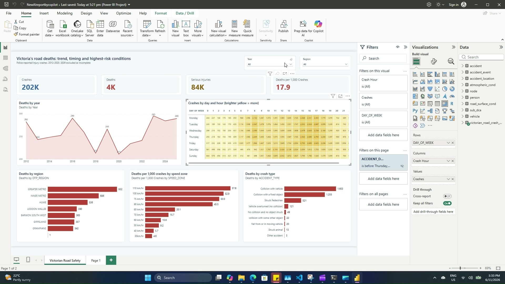

# Victoria Road Crash Data: Power BI Dashboard with GitHub Copilot CLI

A demo of GitHub Copilot CLI and the Microsoft Fabric skills working on a local Power BI project. One plain-English prompt produced a bright road-fatality dashboard with a day-by-hour heatmap, built on open Victorian road crash data.



**Watch the demo:** [Victoria road crash data report in 7 minutes](demo/victoria-road-crash-data-report-in-7-minutes.mp4) (7:16)

## How the demo was built

### 1. Install GitHub Copilot CLI

```powershell
winget install GitHub.Copilot
```

### 2. Add the Fabric skills

Start `copilot`, then run:

```text
/plugin marketplace add microsoft/skills-for-fabric
/plugin install fabric-skills@fabric-collection
/plugin install powerbi-authoring@fabric-collection
```

### 3. Download the data

Download the CSV files from [Victoria road crash data](https://discover.data.vic.gov.au/dataset/victoria-road-crash-data) into one folder.

### 4. Create the Power BI project

In Power BI Desktop, connect all the CSV files, then use **Save as** with the type **Power BI project files (*.pbip)**. The demo file is `NewAIreportbycopilot.pbip`.

### 5. Sign in to Copilot

1. In a terminal, type `copilot`.
2. Type `/login` and choose **GitHub.com**.
3. Choose **Sign in with a device code**.
4. Open `https://github.com/login/device`, enter the one-time code, and authorize GitHub Copilot CLI with your personal GitHub account.

### 6. Give Copilot the prompt

```text
please create a full visualisation dashboard for death caused by accident showing trend and deep analysis keep bright visual theme and heatmap visual for power BI file C:\Users\tause\OneDrive\Documents\FIre Data\NewAIreportbycopilot.pbip
```

### 7. Open the report and refresh

Reopen the project in Power BI Desktop and let the data refresh. The dashboard fills with data.

## What happened in the demo

- Steps 1 and 2 were done before recording, so they aren't in the video. The commands above come from the official [Copilot CLI](https://github.com/github/copilot-cli) and [skills-for-fabric](https://github.com/microsoft/skills-for-fabric) instructions.
- Copilot didn't start from a blank page. It found the existing `Victorian Road Safety Dashboard` project in the same folder, adapted its visuals and measures into the target file, then applied a bright theme and reworked the heatmap.
- That Copilot run took about 2 minutes, from 5:26 PM to 5:28 PM on the on-screen clock. The whole recording spans 5:18 PM to 5:34 PM and is edited to 7:16.
- Copilot said it could not preview the report itself, so the result was checked by opening it in Power BI Desktop.

## What the dashboard shows

Crashes from 2012 to 2025, recalculated from `victorian_road_crash_data.csv`:

| Measure | Value |
| --- | --- |
| Crashes | 202,069 |
| Deaths | 3,607 |
| Serious injuries | 83,956 |
| Deaths per 1,000 crashes | 17.9 |
| Share of deaths in 100 km/h zones | 41.7% |

2026 is left out of the dashboard because that year is incomplete (228 crashes and 35 deaths in this extract).

## What's in this repo

| Path | Contents |
| --- | --- |
| `NewAIreportbycopilot.pbip` | The bright dashboard Copilot produced in the demo |
| `Victorian Road Safety Dashboard.pbip` | The earlier dark dashboard Copilot adapted |
| `FireReport.pbip` | Another dark version of the dashboard |
| `*.csv` | Victoria road crash data |
| `CFA_Incident_Response.xlsx` | CFA incident data, in the folder but not used by the reports |
| `_brief/report-spec.md` | The design brief for the dark dashboard |
| `demo/` | The demo video |
| `repoint-data-path.ps1` | Points the reports at the CSVs on your PC |

## Run it yourself

1. Clone the repo.
2. In PowerShell, run this from the repo folder:

   ```powershell
   powershell -ExecutionPolicy Bypass -File .\repoint-data-path.ps1
   ```

3. Open `NewAIreportbycopilot.pbip` in Power BI Desktop and select **Refresh**.

## Data sources and licence

- [Victoria road crash data](https://discover.data.vic.gov.au/dataset/victoria-road-crash-data), Department of Transport and Planning, CC BY 4.0
- [CFA incident responses](https://discover.data.vic.gov.au/dataset/cfa-incident-responses), CC BY 4.0

Both datasets come from DataVic. The publisher notes that recent crash data is provisional and may change. This is a demo, not an official road safety analysis.
